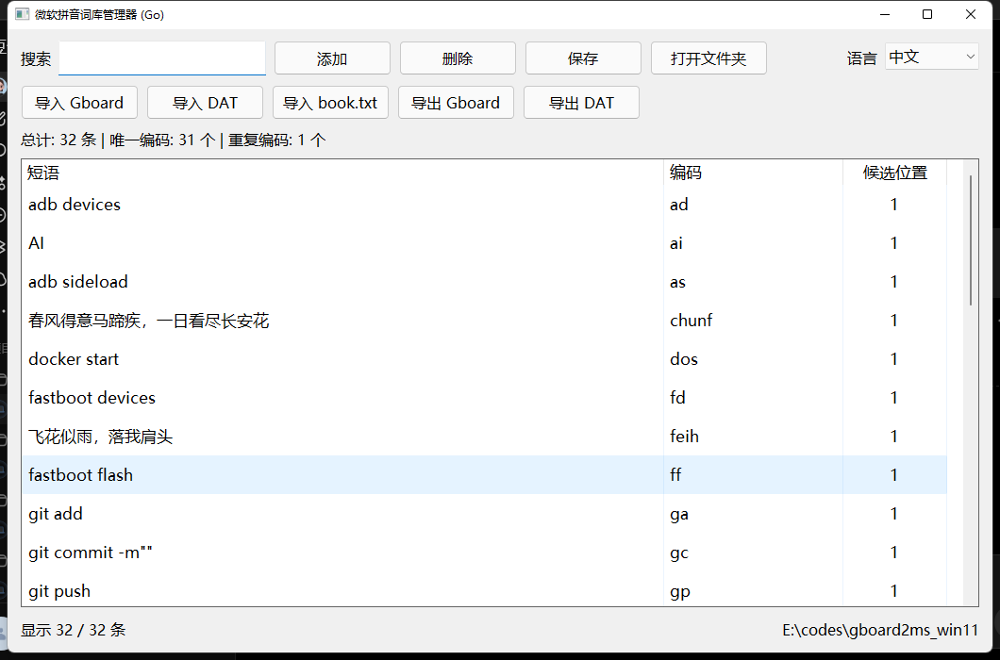
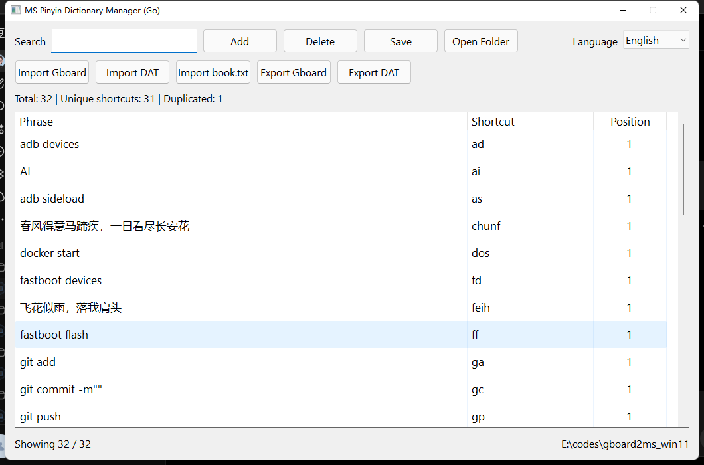

**中文** ｜ [English](#english-manual)

[](https://github.com/luckyme258/gboard2ms_win11/releases/latest)
[](https://github.com/luckyme258/gboard2ms_win11/releases)
[](https://github.com/luckyme258/gboard2ms_win11/issues)
[](#五常见问题)

# 微软拼音词库管理器（Go 版）

> **⬇️ 下载最新版**：到 [Releases](https://github.com/luckyme258/gboard2ms_win11/releases/latest) 下载 **v1.3** 的 `gbord_win11.exe`（约 6.7 MB，双击即用，不需要装 Go、不需要装 Python）。
>
> **⚠️ v1.2 为故障版本**：其「添加 / 编辑词条」点「确定」后会报错或直接闪退，请勿使用，请升级到 v1.3。
>
> **❓ 遇到问题**：请到 [Issues](https://github.com/luckyme258/gboard2ms_win11/issues) 反馈，附上系统版本、操作步骤、报错截图。
>
> Python 旧版（v1.0 及以前）保留在 [luckyme258/gboard2ms_win11_python](https://github.com/luckyme258/gboard2ms_win11_python)。

## 一、简介

微软拼音词库管理器是一个图形化工具，用于管理输入法的自定义短语词库，在内置的 `book.txt` 里统一维护一套条目，再分别导出到两套输入法：

- **Gboard（安卓）**：导出为新版 Gboard 词典包（`.zip`，内含按语言拆分的 `dictionary_*.txt`），可直接在手机 Gboard 的个人词典里导入
- **微软拼音（Windows）**：导出为 `.dat`，可在微软拼音的用户自定义短语里导入

同时支持反向导入：**直接导入手机导出的 Gboard 词典 zip**（不必解压），或导入旧的纯文本词库、微软拼音的 `.dat`。

本版为 **Go + `lxn/walk` 重写**：单个 exe、启动快、无运行时依赖；格式层与 Python 版**逐字节一致**，两边的 zip / DAT 可以互相导入导出。

**界面支持中文 / English 两种语言**：启动时按系统语言自动选择，也可在窗口右上角随时手动切换。

演示放在哔哩哔哩了

使用演示：Gboard自定义词典编辑器 [谷歌输入法（安卓）与微软输入法（Windows）]

[▶️ 点击观看使用演示（B站）](https://www.bilibili.com/video/BV1tj7k6VEeh)

## 界面预览

**中文界面**



**English UI**



> 全白底表格，鼠标所在行由系统原生浅蓝高亮；行高 41px，长词库也不容易串行。


## 二、安装与运行

### 方式一：直接运行 exe（推荐）

1. 到 [Releases](https://github.com/luckyme258/gboard2ms_win11/releases/latest) 下载 `gbord_win11.exe`
2. 放到一个固定文件夹（例如 `D:\Tools\gboard2ms\`），双击运行
3. `book.txt` 会在 exe 同目录自动生成

> 单文件程序，不需要装 Go / Python / 运行库；Windows 10 / 11 均可，**不支持 Win7**（`lxn/walk` 依赖 comctl32 v6 与 PerMonitorV2 DPI）。

### 方式二：自己编译

见文末「附：开发与构建」。

**注意**：`book.txt` 与 `gbord_win11.exe` 放在同一目录；换文件夹时两个一起带走。

## 三、主界面

```
┌──────────────────────────────────────────────────────────────────────────────────┐
│ 搜索: [          ] [添加] [删除] [保存] [打开文件夹]                    语言: [中文 ▾] │
│ [导入 Gboard] [导入 DAT] [导出 Gboard] [导出 DAT]                                   │
├──────────────────────────────────────────────────────────────────────────────────┤
│ 总计: 32 条 | 唯一编码: 31 个 | 重复编码: 1 个                                       │
├──────────────────────────────────────────────────────────────────────────────────┤
│                                                                                  │
│  短语                │ 编码              │ 候选位置                                  │
│  ───────────────────┼──────────────────┼───────────────────────────────────────── │
│  adb devices        │ ad                │ 1                                        │
│  小米9               │ xm                │ 1                                        │
│  git push           │ gp                │ 1                                        │
│  ...                │ ...               │ ...                                      │
│                                                                                  │
├──────────────────────────────────────────────────────────────────────────────────┤
│ 显示 32 / 32 条                                                      就绪          │
└──────────────────────────────────────────────────────────────────────────────────┘
```

> 表格列序与 `book.txt` 的存储顺序是分开的两件事：表格**按「短语在前、编码在后」显示**，`book.txt` **按「编码在前、短语在后」保存**。程序内部只有一套约定：**第 1 列 = 编码（shortcut）、第 2 列 = 短语（word）**，详见第七章。

### 3.1 界面语言（右上角）

- **启动时自动判断**：读取系统显示语言，中文系统用中文界面，其它语言用 English
- **随时手动切换**：点右上角「语言:」下拉框，选 `中文` 或 `English`，界面立即整体切换（按钮、列标题、统计栏、状态栏、右键菜单、所有弹窗文案）
- 切换只影响界面语言，不改动词库数据与导出内容

### 3.2 界面操作小细节

- 鼠标所在的那一行由系统原生浅蓝高亮，一眼就能看清当前指向哪条
- 表格全白底、不铺隔行底纹：屏幕上只有「浅蓝 = 当前行」这一种颜色，不会和灰色底纹混淆
- 行高 41px、字号 13pt，长词库也不挤
- 短语列宽度随窗口自适应，编码列与候选位置列固定宽度

## 四、基本操作

### 4.1 搜索
在搜索框中输入文字，实时过滤显示匹配的词条（短语或编码任一命中即显示）。

### 4.2 添加词条
1. 点击「添加」按钮
2. 填写短语（如：`你好`）
3. 填写编码（如：`nh`）
4. 选择候选位置（1-9，数字越小越靠前）
5. 点击「确定」

### 4.3 编辑词条
- **双击**表格中的任意词条
- 或**右键**点击 → 选择「编辑」
- 修改后点击「确定」

### 4.4 删除词条
- **选中词条**（支持多选），按 `Delete` 键
- 或点击「删除」按钮
- 或右键 →「删除」

### 4.5 多选技巧
| 操作           | 效果              |
| -------------- | ----------------- |
| `Ctrl + 点击`  | 选中/取消选中单个 |
| `Shift + 点击` | 连续选中多个      |
| `Ctrl + A`     | 全选              |
| `Delete`       | 删除选中          |

## 五、导入导出

### 5.1 导入 Gboard 词库（zip）
1. 在手机上打开 Gboard 设置 → 词典 → 个人词典 → 导出，得到一个 `PersonalDictionary-*.zip`
2. 把这个 **zip 原样**传到电脑（不需要解压，程序会自己读里面的 `dictionary_*.txt`）
3. 点击「导入 Gboard」，选择该 zip
4. 程序自动按语言分组读入、去重合并

> - zip 里的文件按内容识别，文件名不必严格叫 `dictionary_zh-CN.txt`；`__MACOSX/`、隐藏文件、目录项会自动跳过
> - 单个 zip 限制 50 个文件 / 20 MB，超限会直接中止并提示，不写入任何数据
> - 仍然兼容旧的纯文本词库：单个 `dictionary.txt` / 2 列旧格式 `.txt` 也能导入（缺少 `version:2` 头部会正常解析并给出告警）
> - 新版格式：第 1 行 `# Gboard Dictionary version:2`，第 2 行格式声明，条目为 `编码 → 短语 → 语言标签 → 候选标记` 四列，行尾保留 Tab
> - 导入只取第 1、2 列，语言标签按短语内容重新判定，不信任文件里写的标签

### 5.2 导入微软拼音 DAT
1. 在微软拼音设置中导出用户自定义短语（得到 `.dat` 文件）
2. 点击「导入 DAT」，选择该文件
3. 程序自动解析并合并（候选位置取自 DAT 条目里记录的候选位）

> 微软拼音 DAT 的词条偏移量是相对「词条区起点」而非文件头，`00 00` 分隔符也必须按 UTF-16LE 的 2 字节边界找——这两点实现错了会读成乱码。本版已按此实现并有回归测试，详见 `格式说明.md`。

### 5.3 导出 Gboard 词典包（zip）
1. 点击「导出 Gboard」
2. 选择保存位置，默认文件名 `Gboard_Dictionary_<时间戳>.zip`
3. 生成的是**一个 zip**，包内按语言拆分：

```
Gboard_Dictionary_20261118_140530.zip
├─ dictionary_zh-CN.txt     ← 所有含中文的条目
└─ dictionary_zz.txt        ← 所有纯英文/符号的条目
```

- **语言自动判断**：短语里含中文（基本区、扩展 A、兼容区、全角标点）→ `zh-CN`；其余 → `zz`
- **一个文件只装一种语言**，中英不混装；若某一语言没有条目，zip 里就不会有那个文件
- 包内每个 txt 都是新版 Gboard 的 `version:2` 格式：固定两行头 + 每条四列 + 行尾留 Tab + 纯 LF 换行 + UTF-8 无 BOM
- 导入手机：把整个 zip 传到手机 → Gboard 设置 → 词典 → 个人词典 → 导入，选择该 zip

### 5.4 导出微软拼音 DAT
1. 点击「导出 DAT」
2. 选择保存位置，默认文件名 `ms_export_<时间戳>.dat`
3. 生成的 `.dat` 可在微软拼音的用户自定义短语里导入（字节级格式见 `格式说明.md`）

### 5.5 保存
点击「保存」把当前数据写回 `book.txt`，写之前会自动把旧文件备份为 `book.txt.bak`。

## 六、文件说明

| 文件                          | 说明                                          |
| ----------------------------- | --------------------------------------------- |
| `gbord_win11.exe`                  | 主程序（约 6.7 MB，单文件）                     |
| `book.txt`                    | 内部统一词库，三列 Tab 分隔                     |
| `book.txt.bak`                | 保存时自动生成的备份                            |
| `Gboard_Dictionary_*.zip`     | Gboard 导出产物（可含多个 `dictionary_*.txt`）  |
| `ms_export_*.dat`             | 微软拼音导出产物                                |
| `格式说明.md`                 | 三套格式（zip v2 / book.txt / DAT）字节级规则   |

## 七、book.txt 格式

内部格式为 Tab 分隔的三列，**第 1 列是编码（shortcut）、第 2 列是短语（word）、第 3 列是候选位置**，程序内部只有这一种约定：

```
# 微软拼音词库 - 统一格式
# 更新时间: 2026-11-18 14:05:00
# 总计: 3 条
# 格式: 编码	短语	候选位置
#--------------------------------------------------
ad	adb devices	1
xm	小米9	1
gp	git push	1
```

### 7.1 列序约定

界面表格按「短语 | 编码 | 候选位置」显示，`book.txt` 按「编码 | 短语 | 候选位置」保存，两者只是显示与存储的差别，内部只有一套顺序。

| 场景 | 取哪一列 |
| ---- | -------- |
| 界面表格 | 第 2 列显示在「短语」、第 1 列显示在「编码」 |
| 统计栏「唯一编码 / 重复编码」 | 按第 1 列（编码）统计 |
| Gboard 导出（zip） | 第 1 列 = shortcut、第 2 列 = word |
| DAT 导出 | 第 1 列 = 编码、第 2 列 = 短语 |
| Gboard 导入 / DAT 导入 | 写回时统一转成「编码在前、短语在后」 |

> Python 的 v0.1 / v0.2（6 月）存在列序反转，v1.0 已修正；Go 版从第一版起就是正确顺序，不存在该问题。

## 八、常见问题

### Q1: 打开程序提示「book.txt 不存在」
A: 程序会自动创建，首次运行正常现象。

### Q2: 导入 Gboard 文件提示错误
A: 先确认文件本身：`.zip` 直接用手机导出的原始 zip（程序会读包内的 `dictionary_*.txt`，不用先解压）；纯文本请确保是 UTF-8。若提示「不是有效的 zip 文件」，说明后缀是 zip 但内容已损坏或被改名。

### Q3: 导出的 DAT 导入微软拼音后乱码
A: 确认 `book.txt` 内容是否正确（编码在前、短语在后），再用本版重新导出；旧版（Python v0.1 / v0.2）导出的 DAT 建议丢弃重导。

### Q4: 如何备份词库？
A: 直接复制 `book.txt`；程序每次保存也会生成 `book.txt.bak`。

### Q5: 支持哪些 Windows 版本？
A: Windows 10 / 11。Win7 不保证（依赖 comctl32 v6 与 PerMonitorV2 DPI）。

### Q6: 导出的 zip 导入手机后词典是空的？
A: 按顺序排查：
1. 导出的是不是本版生成的 zip（旧版导出的 `.txt` 用的是旧头部，新版 Gboard 不认，导入后就是空的）
2. zip 是否被解压过又重命名（应直接把原始 zip 导入，不要只传内层的单个 txt）
3. 导入后到 Gboard「词典 → 个人词典」确认语言条目是否落在对应词典里

### Q7: 导入 DAT 后「输入一长串才出短码」？
A: 这是旧版列序反转造成的（把短语当编码写进 DAT）。用本版重新导出一次 DAT 即可，旧的 `.dat` 丢弃。

### Q8: 界面是英文，能改回中文吗？
A: 右上角「Language:」下拉框选 `中文` 即可；只影响界面显示，不影响数据与导出。

### Q9: Go 版和 Python 版有什么不同？
A: 功能一致、格式互通，差别在分发形态：Go 版是 6.7 MB 单文件 exe、启动快、无运行时依赖；Python 版需要 Python 或 PyInstaller 打包的 12.4 MB exe。新用户建议用本仓库的 Go 版。

## 九、快捷键汇总

| 快捷键     | 功能     |
| ---------- | -------- |
| `Ctrl + A` | 全选     |
| `Delete`   | 删除选中 |
| `双击`     | 编辑词条 |
| `右键`     | 编辑 / 删除 |

## 十、联系与反馈

有问题、建议、新需求，都欢迎提到 **[Issues](https://github.com/luckyme258/gboard2ms_win11/issues)**：

- 🐛 [报告 Bug](https://github.com/luckyme258/gboard2ms_win11/issues/new) —— 请附系统版本（Win10/11）、操作步骤、报错截图
- 💡 [提建议 / 新功能](https://github.com/luckyme258/gboard2ms_win11/issues/new)
- 📖 格式细节有疑问，先看 `格式说明.md`

> 提 issue 前先搜一下有没有重复；词库内容问题（比如某条短语没导进去）请把 `book.txt` 对应那几行贴出来。

---

**版本**：1.3
**更新日期**：2026-11-23

**1.3 更新**（重要修复，建议所有用户升级）：

- **修复「添加 / 编辑词条」点「确定」崩溃**：`walk` 的对话框在关闭瞬间就 `Dispose` 掉整个窗体（`hWnd` 置 0、子控件全部销毁），而旧代码是在 `dlg.Run()` 返回**之后**才去读输入框——这时读到的必然是空串，按键值控件更是在访问已释放对象。这就是点「确定」后弹「短语和编码不能为空」、或者进程直接消失的根因。现在改为在「确定」回调里、窗口关闭**之前**把值取进局部变量，`Run()` 之后不再触碰任何控件。
- 「候选位置」在取值时夹到 1–9，手输越界不再穿透到词库。
- 连点两次「确定」只新增一条，不会重复也不会崩。
- ⚠️ **v1.2 为故障版本**：添加 / 编辑词条不可用，请勿使用。

**上一版（1.2）**：GUI 打磨版 —— 悬停高亮交还系统原生、修复行高 27px→41px、取消隔行灰底、列表双缓冲、新增「导入 book.txt」、字体 12pt 真正生效、产物统一命名 `gbord_win11.exe`。

**更早（v2.0）**：Go 重写、单文件 exe；适配新版 Gboard `version:2` zip 词典包；支持直接导入手机导出的 zip；DAT 导入修复（词条偏移与 `00 00` 对齐）；中英双语界面。

---

# English Manual

**English** ｜ [中文](#微软拼音词库管理器go-版)

[](https://github.com/luckyme258/gboard2ms_win11/releases/latest)
[](https://github.com/luckyme258/gboard2ms_win11/issues)

> **⬇️ Download the latest version**: get **v1.3** (`gbord_win11.exe`, ~6.7 MB) from [Releases](https://github.com/luckyme258/gboard2ms_win11/releases/latest). Single file — no Go, no Python runtime needed.
>
> **⚠️ v1.2 is a faulty build**: "Add / Edit entry" errors out or the process disappears when you press OK. Do not use it — upgrade to v1.3.
>
> **❓ Found a problem**: please open an [issue](https://github.com/luckyme258/gboard2ms_win11/issues) with your Windows version, the steps you took, and a screenshot of the error.
>
> The older Python build (v1.0 and earlier) lives in [luckyme258/gboard2ms_win11_python](https://github.com/luckyme258/gboard2ms_win11_python).

## 1. Overview

Microsoft Pinyin Dictionary Manager is a GUI tool that keeps one single dictionary (`book.txt`) and exports it to two input methods:

- **Gboard (Android)** — exports a Gboard dictionary package (`.zip` containing per-language `dictionary_*.txt`), importable directly in Gboard's personal dictionary
- **Microsoft Pinyin (Windows)** — exports a `.dat` file, importable as user-defined phrases

It also imports backwards: **the Gboard dictionary zip exported by the phone** (no unzipping needed), legacy plain-text dictionaries, and Microsoft Pinyin `.dat` files.

This build is a **Go + `lxn/walk`** rewrite: a single exe, fast startup, no runtime dependencies. The format layer is **byte-for-byte identical** to the Python build, so zip / DAT files are interchangeable in both directions.

**The UI is available in Chinese and English**: picked automatically from the system language at startup, and switchable any time from the top-right corner.

## Screenshots

**Chinese UI**


**English UI**


> All-white rows; the row under the pointer is highlighted in the system's native light blue. Row height is 41px, so long dictionaries stay readable.


## 2. Installation

### Option 1: run the executable (recommended)

1. Download `gbord_win11.exe` from [Releases](https://github.com/luckyme258/gboard2ms_win11/releases/latest)
2. Put it in a fixed folder (e.g. `D:\Tools\gboard2ms\`) and double-click it
3. `book.txt` is created automatically next to the exe

> Single-file program — no Go, no Python, no runtime needed. Windows 10 / 11 only; **Win7 is not supported** (the GUI relies on comctl32 v6 and PerMonitorV2 DPI).

### Option 2: build it yourself

See "Appendix: build & development" at the end.

**Note**: `book.txt` lives next to `gbord_win11.exe` — move both together.

## 3. Main Window

```
┌──────────────────────────────────────────────────────────────────────────────────┐
│ Search: [        ] [Add] [Delete] [Save] [Open Folder]                Language: [English ▾] │
│ [Import Gboard] [Import DAT] [Export Gboard] [Export DAT]                            │
├──────────────────────────────────────────────────────────────────────────────────┤
│ Total: 32 | Unique shortcuts: 31 | Duplicated: 1                                     │
├──────────────────────────────────────────────────────────────────────────────────┤
│   Phrase            │ Shortcut          │ Position                                   │
│  ───────────────────┼──────────────────┼─────────────────────────────────────────   │
│   adb devices       │ ad                │ 1                                          │
│   小米9              │ xm                │ 1                                          │
│   git push          │ gp                │ 1                                          │
├──────────────────────────────────────────────────────────────────────────────────┤
│ Showing 32 / 32                                                          Ready        │
└──────────────────────────────────────────────────────────────────────────────────┘
```

> The table shows "Phrase | Shortcut | Position" while `book.txt` stores "shortcut | phrase | position" — that is only a display/storage difference. Internally there is a single convention: **column 1 = shortcut, column 2 = phrase**.

### 3.1 Interface language (top-right)

- **Auto-detected at startup**: the system display language is read — Chinese systems get the Chinese UI, everything else gets English
- **Switch any time**: pick `中文` or `English` in the `Language:` dropdown; every label, column header, stats bar, status bar, context menu and dialog is retranslated immediately
- Switching only changes the interface language — it never touches your data or the exported files

### 3.2 Small niceties

- The row under the mouse cursor highlights in pale yellow
- Alternating row backgrounds keep long dictionaries readable
- The phrase column stretches with the window; shortcut and position columns stay fixed

## 4. Basic Operations

### 4.1 Search
Type in the search box to filter entries live (matches either the phrase or the shortcut).

### 4.2 Add an entry
1. Click **Add**
2. Enter the phrase (e.g. `hello`)
3. Enter the shortcut (e.g. `he`)
4. Pick a position (1-9, smaller comes first)
5. Click **OK**

### 4.3 Edit an entry
- **Double-click** any row, or right-click → **Edit**
- Change the values and click **OK**

### 4.4 Delete entries
- Select the rows (multi-select supported) and press `Delete`
- Or click **Delete**, or right-click → **Delete**

### 4.5 Multi-select

| Action | Effect |
| --- | --- |
| `Ctrl + click` | toggle a single row |
| `Shift + click` | select a contiguous range |
| `Ctrl + A` | select all |
| `Delete` | delete the selection |

## 5. Import / Export

### 5.1 Import a Gboard dictionary (zip)
1. On the phone: Gboard → Dictionary → Personal dictionary → Export, which produces `PersonalDictionary-*.zip`
2. Copy that **zip as-is** to the PC — the tool reads the inner `dictionary_*.txt` itself
3. Click **Import Gboard** and pick the zip
4. Entries are grouped by language and merged with de-duplication

> - Files inside the zip are recognised by content, so they need not be named `dictionary_zh-CN.txt` exactly; `__MACOSX/`, hidden files and directory entries are skipped
> - A single zip is limited to 50 files / 20 MB; larger archives abort without writing anything
> - Legacy plain-text dictionaries still import (a single `dictionary.txt` or an old two-column `.txt`); a missing `version:2` header is parsed but warned about
> - New format: `# Gboard Dictionary version:2` on line 1, the format line on line 2, then four tab-separated fields `shortcut → word → language_tag → pos_tag`, trailing tab preserved
> - Only columns 1 and 2 are used; the language tag is re-derived from the phrase instead of trusting the file

### 5.2 Import a Microsoft Pinyin DAT
1. Export the user-defined phrases from Microsoft Pinyin settings (a `.dat` file)
2. Click **Import DAT** and pick the file
3. Entries are parsed and merged (the position stored in each entry is kept)

> In the DAT, entry offsets are relative to the **entry area start**, and `00 00` separators must be scanned on **UTF-16LE 2-byte boundaries** — get either wrong and the whole file reads as garbage. This build follows both rules and has regression tests; see `格式说明.md`.

### 5.3 Export a Gboard dictionary package (zip)
1. Click **Export Gboard**
2. Pick a location; the default name is `Gboard_Dictionary_<timestamp>.zip`
3. The result is **one zip**, split by language:

```
Gboard_Dictionary_20261118_140530.zip
├─ dictionary_zh-CN.txt     ← entries containing Chinese
└─ dictionary_zz.txt        ← pure ASCII entries
```

- **Language detection**: a phrase containing Chinese characters (base block, extension A, compatibility block, full-width punctuation) → `zh-CN`; anything else → `zz`
- **One language per file**, never mixed; a language with no entries gets no file
- Every inner txt follows Gboard's `version:2` format: two fixed header lines, four fields per entry, trailing tab, LF-only endings, UTF-8 without BOM
- On the phone: copy the zip over → Gboard → Dictionary → Personal dictionary → Import → choose the zip

### 5.4 Export a Microsoft Pinyin DAT
1. Click **Export DAT**
2. Pick a location; the default name is `ms_export_<timestamp>.dat`
3. Import it in Microsoft Pinyin's user-defined phrases (byte-level format in `格式说明.md`)

### 5.5 Save
**Save** writes the current data back to `book.txt`, backing up the previous file as `book.txt.bak`.

## 6. Files

| File | Description |
| --- | --- |
| `gbord_win11.exe` | the application (~6.7 MB, single file) |
| `book.txt` | the single internal dictionary, three tab-separated columns |
| `book.txt.bak` | automatic backup created on save |
| `Gboard_Dictionary_*.zip` | Gboard export (may contain several `dictionary_*.txt`) |
| `ms_export_*.dat` | Microsoft Pinyin export |
| `格式说明.md` | byte-level rules for the three formats |

## 7. book.txt format

Three tab-separated columns: **column 1 = shortcut, column 2 = phrase, column 3 = position**. That is the only internal convention.

```
ad	adb devices	1
xm	小米9	1
gp	git push	1
```

### 7.1 Column order

The table displays "Phrase | Shortcut | Position"; `book.txt` stores "shortcut | phrase | position". Display and storage differ, the internal order never does.

| Where | Which column is used |
| --- | --- |
| Table | column 2 under "Phrase", column 1 under "Shortcut" |
| Stats bar (unique / duplicated shortcuts) | counted on column 1 |
| Gboard export (zip) | column 1 = shortcut, column 2 = word |
| DAT export | column 1 = shortcut, column 2 = phrase |
| Gboard / DAT import | normalised to "shortcut first, phrase second" |

> The Python v0.1 / v0.2 builds (June) had the reversal, fixed in v1.0. The Go build never had it.

## 8. FAQ

### Q1: "book.txt not found" on startup
A: It is created automatically; normal on first run.

### Q2: Error when importing a Gboard file
A: Check the file first: for a `.zip`, use the original zip exported by the phone (the tool reads the inner `dictionary_*.txt`); for plain text, make sure it is UTF-8. An error saying it is not a valid zip means the extension says zip but the archive is corrupt or renamed.

### Q3: Garbled text after importing the DAT into Microsoft Pinyin
A: Check that `book.txt` has shortcut first, phrase second, then re-export with this build; discard DAT files from older builds.

### Q4: How do I back up my dictionary?
A: Copy `book.txt`. Every save also produces `book.txt.bak`.

### Q5: Which Windows versions are supported?
A: Windows 10 / 11. Win7 is not guaranteed.

### Q6: After importing the zip, the phone dictionary is empty
A: Check in this order:
1. Was the zip produced by this build? A `.txt` from an older build uses the old header, which the new Gboard rejects
2. Was the zip unzipped and renamed? Import the original zip as-is
3. In Gboard → Dictionary → Personal dictionary, check which dictionary the entries landed in

### Q7: In the DAT, typing a long string produces a short code
A: That is the reversal of older builds. Re-export the DAT with this build and discard the old one.

### Q8: The UI is in English, can I get Chinese back?
A: Pick `中文` in the `Language:` dropdown at the top-right. It only affects the interface.

### Q9: How does the Go build differ from the Python one?
A: Same features, interchangeable formats. The difference is distribution: Go ships a 6.7 MB single exe with instant startup and no runtime; Python needs a Python install or a 12.4 MB PyInstaller exe. New users should use this Go build.

## 9. Shortcuts

| Key | Action |
| --- | --- |
| `Ctrl + A` | select all |
| `Delete` | delete selection |
| double-click | edit an entry |
| right-click | edit / delete |

## 10. Feedback

Bugs, suggestions and feature requests are welcome in **[Issues](https://github.com/luckyme258/gboard2ms_win11/issues)**:

- 🐛 [Report a bug](https://github.com/luckyme258/gboard2ms_win11/issues/new) — please include your Windows version, the steps, and a screenshot of the error
- 💡 [Suggest a feature](https://github.com/luckyme258/gboard2ms_win11/issues/new)
- 📖 For format details, read `格式说明.md` first

---

**Version**: 1.3
**Date**: 2026-11-23

**1.3 — critical fix, please upgrade**:

- **Fixed the crash when pressing OK in "Add / Edit entry"**: `walk` disposes the whole dialog the moment it closes (`hWnd` set to 0, every child control destroyed), while the old code read the edit boxes *after* `dlg.Run()` returned — those reads can only yield empty strings, and value-style controls were touching an already-released object. That is why pressing OK either popped "phrase and shortcut must not be empty" or made the process vanish. Values are now captured inside the OK handler, **before** the window closes, and `Run()` is followed by no control access at all.
- "Position" is clamped to 1–9 at capture time, so an out-of-range typing can no longer reach the dictionary.
- Double-clicking OK twice adds exactly one entry — no duplicate, no crash.
- ⚠️ **v1.2 is a faulty build**: add / edit is unusable; do not use it.

**Previous (1.2)**: UI polish build — hover given back to the native hot area, row height 27px → 41px, alternating grey removed, double-buffered list, new "Import book.txt", 12pt fonts actually applied, artifact named `gbord_win11.exe`.

**Earlier (v2.0)**: Go rewrite with a single-file exe; Gboard `version:2` zip dictionary packages; direct import of the phone-exported zip; DAT import fixes (entry offset and `00 00` alignment); bilingual UI.

---

# 附：开发与构建

面向想自己编译或改代码的人。普通用户不用看这一节。

## 目录结构

```
gboard2ms_win11\
├─ go.mod
├─ build.cmd             # 发布构建入口（-s -w，出 6.7 MB）
├─ README.md
├─ 格式说明.md            # 三套格式 + 硬约束速查
├─ 技术选型分析.md
├─ internal\core\        # 格式层（唯一实现，GUI 与 CLI 共用）
│   ├─ core.go           # Entry / LoadBook / SaveBook / ExportZip / ImportZip / ExportDat / ParseDat / LangTag
│   ├─ core_test.go      # DAT 往返 / zip 往返 / 旧 txt 兼容 / 语言判定
│   └─ errors.go
├─ cmd\walkui\           # GUI
│   ├─ main.go           # 界面 + 事件 + 中英文案表
│   ├─ app.manifest      # comctl32 v6 + PerMonitorV2（视觉样式 / 高 DPI）
│   └─ rsrc.syso         # 由 app.manifest 生成，构建时自动嵌入
├─ spike\main.go         # 格式层 CLI（复用 internal/core）
├─ gbord_win11.exe            # GUI 产物（本地，不入库，走 Release 附件）
├─ spike.exe             # CLI 产物（本地，不入库）
├─ book.txt              # 词库（本地，不入库）
└─ out\                  # 试跑输出（本地，不入库）
```

## 环境

Go 不必装到系统 PATH，用便携版即可：

```powershell
$env:GOROOT  = 'E:\codes\_toolchains\go'
$env:GOPATH  = 'E:\codes\_toolchains\gopath'
$env:GOCACHE = 'E:\codes\_toolchains\gocache'
$env:GOPROXY = 'https://goproxy.cn,direct'      # go.dev 直连不通，走国内镜像
& "$env:GOROOT\bin\go.exe" version               # go1.27.4 windows/amd64
```

## 构建

```powershell
Set-Location 'E:\codes\gboard2ms_win11'

# 发布构建（已固化成脚本，推荐）
build.cmd          # -s -w -H=windowsgui，出 6.68 MB
build.cmd debug    # 带调试信息，出 10.4 MB

# 手动构建
Set-Location cmd\walkui
& "$env:GOPATH\bin\rsrc.exe" -manifest app.manifest -o rsrc.syso   # 仅 manifest 变更时需要
Set-Location ..\..
& "$env:GOROOT\bin\go.exe" build -ldflags "-s -w -H=windowsgui" -o gbord_win11.exe ./cmd\walkui

# CLI
& "$env:GOROOT\bin\go.exe" build -o spike.exe ./spike
```

**发布构建必须带 `-s -w`**：默认构建会嵌入 DWARF 与符号表（约 3.3 MB，占三分之一）。

| 构建方式 | 体积 |
| --- | --- |
| `go build -ldflags "-H=windowsgui"`（带调试信息） | 10.43 MB |
| `go build -ldflags "-s -w -H=windowsgui"`（发布） | **6.68 MB** |

`-s` 去符号表、`-w` 去 DWARF，机器码与 `pclntab` 都保留，panic 仍能打印函数名与行号，只是不能挂调试器。**不用 UPX**：不减少内存占用、杀软误报、启动变慢、崩溃分析困难。

## 界面规范（字体 / 间距）

| 层级 | 规格 |
|---|---|
| 工具栏、标签、状态栏 | Microsoft YaHei UI **12pt**（英文 Segoe UI 12pt） |
| 表格行与表头 | 同族字体 **13pt**；行高强制 **40px**；鼠标所在行浅黄 `#FFF9C4` |
| 输入框（搜索 / 短语 / 编码 / 候选位置） | 同族字体 **14pt**，高度 32px（原生 EDIT 不随字体长高，必须显式给高度，否则字被裁） |
| 对话框 | 520×330，标签列固定 80，输入框 300×32，数字框 88×32，按钮 100×34 |
| 窗口 | 1060×680，最小 940×580（1366×768 下不会被任务栏挡住）；内距 14/12/14/10，区块间距 10 |

已知限制：`walk.MsgBox` 是系统 MessageBox，字体改不了；表头不支持单独加粗（walk 的 header 与行共用同一字体）。行高不能用 `CustomRowHeight`（设了会让 `applyFont` 提前 return、字体失效），也不能发 `LVM_SETITEMHEIGHT`（会让 comctl32 崩），只能用「1×30 空图像列表挂到 `LVSIL_SMALL`」撑高。

未实现：表头点击排序（已关闭，避免与词库顺序冲突）、拖拽排序。

## 格式层自检

```powershell
go test ./internal/core -v                          # 单元测试
.\spike.exe export-zip  book.txt out\go2.zip
.\spike.exe export-dat  book.txt out\go2.dat 1790000000   # 固定时间戳便于比对
.\spike.exe roundtrip   book.txt out\rt
```

最近一次结果：

```
TestDatRoundtrip / TestZipRoundtrip / TestImportLegacyTxt / TestLangTag : PASS
导出 zip: zh-CN 17 / zz 15
导出 dat: 32 条 / 1600 B
zip 内层逐字节一致（vs Python）: True
DAT 1600 B 逐字节一致（vs Python）: True
Go 解析 DAT: 32 条，与源数据一致
```

## 注意

- 三套格式的字节级规则与 9 条硬约束见 `格式说明.md`；DAT 解析的两个坑（偏移相对词条区、`00 00` 必须按 2 字节边界找）已写成 `core_test.go` 的回归用例。
- `zip` 不能比原始字节：Go 每次写 zip 的 `Modified` 秒级不同，只比**解压后内容**。
- `book.txt` 统一 CRLF；短语按 `[]rune` 切前 2 字符（否则中文 / emoji 会被切坏）。
- `TableView` 列必须用 `walk.NewTableViewColumn()` + `SetTitle/SetWidth` 构造，不能结构字面量；`SetTextColor`、`SetFont` 都不返回值，写成 `_ =` 会编译失败。
- 表格列序：**短语、编码、候选位置**（显示层），内部 `Entry{Code, Phrase, Pos}` 永远是编码在前。
